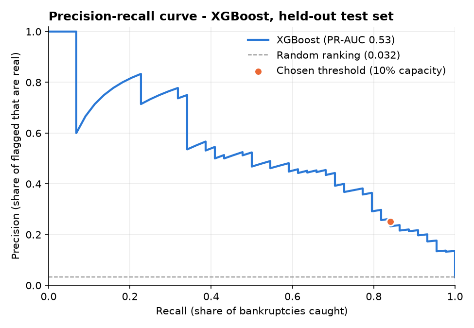
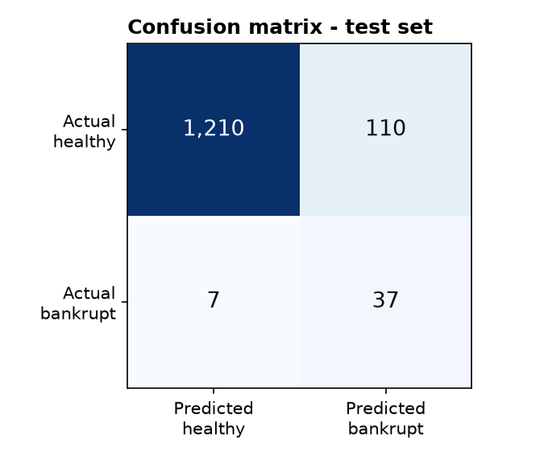
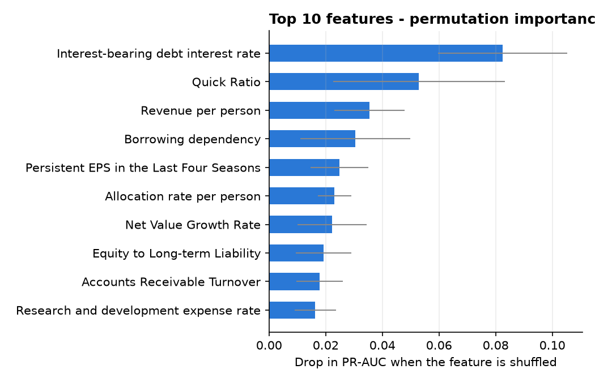

# Bankruptcy Risk Scoring on 6,819 Taiwanese Company Records

An analyst with a watch-list of companies and limited time has to decide which files to open first. This project ranks 6,819 company records from the Taiwan Economic Journal (1999–2009) by how closely their 92 financial ratios match the profile of records that ended in bankruptcy.

On held-out data, reviewing the 147 highest-scoring records (10.8%) surfaced **37 of the 44 bankruptcies**. Reviewing at random, the same workload would find about 5.

**Research question:** *Can machine learning identify companies exhibiting financial characteristics associated with bankruptcy, using financial ratios, and provide interpretable risk scores that help financial analysts prioritise companies for further investigation?*

---

## Why I built it

I am interested in how investment teams monitor the companies they hold or lend to. This project explores the risk-screening side of that work: given only the financial ratios of a set of companies, can a model tell an analyst where to look first? It is also my first end-to-end machine learning project, so each decision below is documented with the evidence behind it, including the ones that turned out not to help.

---

## Key results

| | Value |
|---|---|
| Final model | XGBoost (selected by highest cross-validated PR-AUC) |
| Test set | 1,364 observations, 44 bankrupt (held out from model fitting and selection) |
| ROC-AUC (test) | **0.963** |
| Average Precision (AP; used as the PR-AUC metric), test | **0.533** (random ranking = 0.032) |
| Threshold fixed at 10% capacity (on training data) | **37 of 44 bankruptcies caught (84%)** by reviewing 147 test records (10.8%) |
| Precision at that threshold | 25%: about 1 in 4 reviewed records was bankrupt, vs 3.2% base rate |

Cross-validated PR-AUC on the training set was 0.459 ± 0.061. The test score is higher, but with only 44 bankrupt observations in the test set, results vary considerably; the cross-validated estimate should be treated as the more conservative expectation.

---

## End user and use case

**User:** a credit-risk or investment analyst at an investment firm who monitors a set of companies and has limited time for in-depth financial reviews.

**Purpose:** the model scores each company record on how closely its financial ratios resemble those of records labelled bankrupt in this dataset (Taiwanese companies, 1999–2009). Records are then ranked from highest to lowest score so the analyst can decide which to review first. The model supports the analyst's judgement; it does not make lending or investment decisions.

- **Risk scores, not probabilities:** the XGBoost output is used only to rank records. The scores were not calibrated, so a score of 0.30 does not mean a 30% chance of bankruptcy; a score is only meaningful relative to other records' scores.
- **Review capacity and threshold:** the analyst team is assumed to be able to review 10% of records. The threshold (score ≥ 0.0190) is the score at the 10% cut-off in out-of-fold predictions on the training set, fixed before the test set was evaluated. Because the threshold is fixed in advance, it does not flag exactly 10% of new records (147 test records, 10.8%). The 10% capacity is an illustrative assumption; the capacity table in the results shows 5–20%.
- **Error costs:** missing a record with a bankruptcy profile (false negative) is treated as more costly than reviewing a healthy one (false positive). The review capacity is therefore set to favour catching bankrupt records, accepting that most reviewed records will be false alarms.
- **Screening, not forecasting:** the dataset does not record when the ratios were measured relative to bankruptcy. The model identifies records whose ratios match the bankruptcy profile in this historical data; it does not predict whether or when a company will go bankrupt and is not an early-warning system.

---

## The dataset and what made it tricky

Taiwanese Bankruptcy Prediction dataset, Taiwan Economic Journal, 1999–2009. Bankruptcy is defined by the business regulations of the Taiwan Stock Exchange.
Source: [UCI Machine Learning Repository](https://archive.ics.uci.edu/dataset/572/taiwanese+bankruptcy+prediction) (DOI 10.24432/C5004D), licensed CC BY 4.0. Related paper: Liang, D., Lu, C.-C., Tsai, C.-F., & Shih, G.-A. (2016). *Financial ratios and corporate governance indicators in bankruptcy prediction: A comprehensive study.* European Journal of Operational Research, 252(2), 561–572.

6,819 observations (company records), 95 financial ratios, binary target `Bankrupt?`. No missing values and no duplicate rows. Notebook 01 found six things that shaped everything after:

1. **Only 220 records (3.2%) are bankrupt.** A model that answers "healthy" for every record scores 96.8% accuracy and catches none of them.
2. **The file does not match its documentation.** The linked paper describes a balanced sample of 478 firms; this file has 6,819 rows and 220 bankruptcies, and how it was built is not documented. There is no company identifier or year, so it cannot be verified that each row is a unique company.
3. **24 columns hide a second scale.** Most values sit between 0 and 1, but in these columns some values range from about 580,000 up to exactly 10,000,000,000, rounded to three significant digits. In the training data, `Cash Turnover Rate` has a 25th percentile of 0.0003 and a median of 1.14 billion. No source explains these values, and they contradict the rest of some records: record 2490 has a `Total debt/Total net worth` of 474 million while sitting at the 0.1st percentile of `Debt ratio %`. They were kept unchanged rather than "fixed" with a guess.
4. **The other 69 ratios each run from exactly 0 to exactly 1**, usually with a single record on each bound. This is consistent with min-max scaling applied before publication (not documented for this file), so raw financial values cannot be recovered.
5. **`Net Income Flag` contradicts its own definition.** It is documented as "1 if net income is negative for the last two years" but equals 1 for all 6,819 records, profitable ones included. Dropped.
6. **Two pairs of columns are the same data under different names:** `Current Liabilities/Liability` = `Current Liability to Liability`, and `Current Liabilities/Equity` = `Current Liability to Equity`. Verified identical row by row, then one of each dropped.

Records sitting at the extremes of many columns were inspected before deciding whether to remove them. Record 6610 holds the maximum of six profitability ratios and is cash-rich with no long-term debt; record 5015 has almost no revenue, so ratios with revenue in the denominator hit their extremes (expense and cash-flow-to-sales ratios at the maximum, operating margins at the minimum). Their ratios are internally consistent, so **no rows were removed**. Final feature set: **92 features**.

---

## Decisions and the evidence behind them

1. **Split first, then lock the test set.** Stratified 80/20 split (seed 42) before any modelling: 176 bankrupt records for training, 44 for testing. The test set was held out from model fitting and model selection. It was used for final performance evaluation and post-hoc permutation importance.
2. **Every comparison uses 5-fold stratified cross-validation on the training set**, with preprocessing inside scikit-learn pipelines so it is learned within each training fold only (no additional preprocessing leakage). Although pipeline-based preprocessing was fitted within each training fold, the original dataset appears to have undergone scaling before publication. This potential source-level leakage cannot be reversed using the available data.
3. **One `log1p` rule for all 92 columns, not a list of the 24 large-value columns.** Logistic Regression needs comparable scales; `log1p` turns 10 billion into about 23 while barely changing values between 0 and 1, keeps the order, and learns nothing from the data. Applying it everywhere mattered: `Current Ratio` has only one huge value (2.75 billion), and the split put it in the test set. A list built from the training data would have contained 23 columns and let that value through untransformed. All values are ≥ 0, so `log1p` is valid everywhere. Tree models use the raw values because they depend only on value order.
4. **Metrics chosen for a 3.2% minority class:** PR-AUC, computed as Average Precision (AP) with scikit-learn's `average_precision_score`, is the primary metric, alongside ROC-AUC, recall, precision, F1 and the confusion matrix. Accuracy is reported only to show why it is misleading.
5. **Class weights tested, then dropped.** `class_weight="balanced"` lifted Logistic Regression's recall at the default 0.5 threshold from 22% to 75%, but PR-AUC did not improve (0.380 vs 0.337) and, at a 10% review workload, it caught 122 bankruptcies against 124 without weights. Models were instead compared at equal workload: how many bankruptcies each finds when analysts review the top 5/10/15/20% of records.
6. **Threshold set from review capacity, not 0.5.** At 0.5, unweighted Logistic Regression flagged only 79 records. The final threshold is the score at the 10% cut-off in out-of-fold training predictions: 0.0190, far below 0.5.
7. **Selection rule written before the comparison was run:** highest mean cross-validated PR-AUC. Notebook 05 saves the winner to `results/selected_model.txt` and notebook 06 reads it, so the final evaluation cannot silently use a different model.
8. **Explainability:** permutation importance on the test set (drop in PR-AUC when a feature is shuffled).

---

## Results

### 1. Baseline (notebook 03, 5-fold CV)
| Model | Accuracy | Recall | ROC-AUC | PR-AUC |
|---|---|---|---|---|
| Always "not bankrupt" | **0.968** | **0.000** | 0.500 | 0.032 |
| Random guess (3.2% rate) | 0.938 | 0.023 | 0.496 | 0.033 |

A model that never predicts bankruptcy is 96.8% accurate and catches none of the 176 bankrupt training observations, so accuracy is misleading here.

### 2. Class weights (notebook 04, Logistic Regression, 5-fold CV)
| | Recall (threshold 0.5) | Precision (threshold 0.5) | PR-AUC | Bankruptcies caught at 10% capacity |
|---|---|---|---|---|
| No class weights | 0.222 | 0.488 | 0.380 | 124 |
| `class_weight="balanced"` | 0.750 | 0.168 | 0.337 | 122 |

Balanced class weights increased recall at the default 0.5 threshold but did not improve ranking quality, as measured by PR-AUC. At equal review capacity, the unweighted model performed as well or better, so later models were trained without class weights and thresholds were set from review capacity instead.

### 3. Model comparison (notebook 05, 5-fold CV, training set)
| Model | PR-AUC | ROC-AUC | Caught at 10% capacity (546 reviewed) |
|---|---|---|---|
| Logistic Regression | 0.380 ± 0.043 | 0.912 ± 0.022 | 124 / 176 |
| Random Forest | 0.442 ± 0.051 | 0.938 ± 0.024 | 134 / 176 |
| **XGBoost** | **0.459 ± 0.061** | **0.940 ± 0.020** | **139 / 176** |

Both tree-based models achieved higher cross-validated PR-AUC than Logistic Regression in this experiment (no formal significance test was performed). XGBoost had the highest mean PR-AUC; the gap to Random Forest is smaller than the fold-to-fold variation, so the two perform comparably.

### 4. Final evaluation (notebook 06, held-out test set)
| Review capacity | Records reviewed | Bankruptcies caught | Recall | Precision |
|---|---|---|---|---|
| 5% | 68 | 30 / 44 | 68.2% | 44.1% |
| 10% | 136 | 36 / 44 | 81.8% | 26.5% |
| 15% | 205 | 41 / 44 | 93.2% | 20.0% |
| 20% | 273 | 42 / 44 | 95.5% | 15.4% |

The table above ranks the test observations and takes **exactly** the top k (for 10%: 136 records, 36 caught).

In deployment, the threshold is fixed in advance. Using the score threshold set on training data (≥ 0.0190, the 10% cut-off in out-of-fold training predictions), the model flagged **147 test records (10.8%)**, catching **37 of 44** bankruptcies, missing 7, with 110 false alarms (recall 0.841, precision 0.252, F1 0.387). The fixed threshold flagged slightly more than 10% because test scores are distributed slightly differently from the training scores; the 11 extra records contained one additional bankruptcy.





### 5. Which ratios drive the predictions?


**Importance** was measured with permutation importance on the test set: each feature is shuffled 20 times and the average drop in the model's PR-AUC is recorded. The most influential features were the interest-bearing debt interest rate, quick ratio, revenue per person, borrowing dependency and persistent EPS.

**Direction** is a separate, simpler check: median values of these features for healthy vs bankrupt observations in the training data (association only, not the model's internal logic). Where it is clear, it is financially sensible: bankrupt observations show **lower liquidity** (quick ratio), **lower earnings** (persistent EPS), **higher borrowing dependency** and **higher interest rates on their debt**. For revenue per person the medians are close and the direction is not interpretable.

**Interpretation limits:**
- This is **predictive importance, not causation**.
- 7 of the 10 most important features are among the 24 columns containing undocumented large values, so the model may partly rely on how those values were encoded rather than on the underlying financial ratio.
- Correlated features (e.g., several ROA variants) share importance, which can make each one look less important individually.
- Values are pre-scaled, so effects can only be described as directions (higher/lower), not in real financial units.

---

## Limitations

- **Undocumented dataset construction:** the UCI file (6,819 rows, 220 bankrupt) differs from the sample described in the linked paper (478 firms, balanced); how it was built is not documented.
- **No company ID or year:** rows are observations; the same company may appear more than once, possibly in both training and test sets, which could make results optimistic.
- **Timing unknown:** the dataset does not establish when ratios were measured relative to bankruptcy, so **no early-warning claim is made**.
- **Pre-scaled features:** scaling appears to have been computed on the full dataset (including test rows) before publication; raw financial values cannot be recovered.
- **Unknown meaning of large values** in 24 columns.
- **Small minority class:** 176 bankrupt observations in training and 44 in test, so metrics vary noticeably between data splits.
- **No hyperparameter tuning:** models use reasonable defaults; tuning could change results modestly.
- **Scores are not calibrated probabilities.**
- **Assumed review capacity:** 10% is illustrative; the capacity table shows other options.
- **Scope:** records of Taiwanese companies, 1999–2009; results may not generalise to other markets or periods.
- **Input check:** `log1p` assumes non-negative inputs (true for this dataset); new data would need validation.

---

## Conclusions

1. Financial ratios carry a strong signal: the final model ranks records far better than chance (test PR-AUC 0.53 vs 0.03 random; cross-validated 0.46).
2. Reviewing the 10% highest-risk records would have surfaced about 8 in 10 bankruptcies in the test set, with roughly 1 in 4 reviewed records being a real case: an ~8× improvement over random review.
3. Tree-based models (XGBoost, Random Forest) achieved higher cross-validated PR-AUC than Logistic Regression in this experiment.
4. On this data, the decision threshold mattered more than class weighting: the 0.5 default flagged too few records, and class weighting did not improve PR-AUC. Setting the threshold from analyst capacity gave a workload the team can plan around.
5. The model is suitable as a **screening and prioritisation tool**, not as an early-warning or automated decision system, given the dataset limitations above.

## What I would do next

- **Get data with company identifiers and fiscal years**, so the same company can be kept on one side of the split and ratios can be dated relative to bankruptcy.
- **Ask the data provider what the large values in the 24 columns encode**, since 7 of the 10 most important features depend on them.
- **Calibrate the scores** before showing them to analysts as numbers.
- **Add SHAP explanations per record**, so an analyst sees why a specific company was flagged.

---

## Repository structure

```
├── data/
│   ├── data.csv                  # original dataset (UCI, CC BY 4.0)
│   ├── train.csv                 # 80% stratified training split
│   └── test.csv                  # 20% held-out test split
├── images/                       # charts used in this README
├── results/                      # CV comparison table, selected model
├── 01_dataset_understanding.ipynb
├── 02_train_test_split.ipynb
├── 03_baseline_dummy.ipynb
├── 04_logistic_regression.ipynb
├── 05_model_comparison.ipynb
├── 06_final_evaluation.ipynb
└── requirements.txt
```

## How to run

```bash
python -m venv .venv
.venv\Scripts\activate            # Windows  (macOS/Linux: source .venv/bin/activate)
python -m pip install -r requirements.txt
```
Run the notebooks in order (01 → 06). All random seeds are fixed (`random_state=42`).

**Tools:** Python, pandas, NumPy, scikit-learn, XGBoost, matplotlib

---

*Author: Lamis Toumi*
